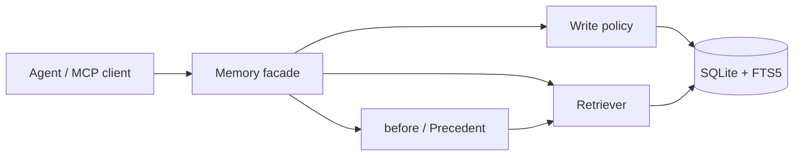

# agent-memory

> Decision memory for LLM agents: remember what was decided, what happened, and what to do differently next time.

<!-- Optional badges: replace OWNER/REPO after publishing. -->


## Why

Agents forget decisions. A vector store remembers *what was said*; it does not
remember **what was decided, why, what happened next, and what that should
change about the next decision**.

## What it does

- `fact` / `episode` / `decision` memory model;
- outcome declared by the caller (`success` / `failure` / `mixed` / `unknown`);
- `before(action)` recalls precedents by **action_type**, not entity;
- SQLite FTS5 + explicit evidence fusion; every hit has `why` and `signals`;
- versioned facts, protected decisions, type-aware forgetting;
- MCP server for Claude Desktop / Cursor.

## Architecture



## Quickstart

```bash
pip install -e ".[dev]"
pytest -q
python -m agent_memory.evaluation
python examples/agent_loop.py
```

```python
from agent_memory import Memory

mem = Memory("memory.db")
rec = mem.remember(
    type="decision", entity="供应商A",
    content="决定换成供应商B",
    action_type="supplier_switch",
    structured={"decision": "换成供应商B", "rationale": "交期延迟"},
)
mem.record_outcome(rec.id, outcome="B 断货两周",
                   lesson="先评估备选产能", status="failure")
print(mem.before("supplier_switch").to_prompt())
```

## Evaluation

- 13/13 retrieval cases (24 same-entity distractors each);
- 8/8 intervention cases;
- held-out 2/2;
- 55 tests;
- `keyword_only` ablation shows lexical is the main signal, so 100% is a
  regression result, not a generalisation claim.

## Limitations

- no vector DB; no synonym matching without an embedder;
- single-process SQLite, no WAL;
- small evaluation set;
- `action_type` typos return `no_history` (visible false negative).

## License

MIT
